# Splatsam

**A desk video → an estimated physics scene → an honestly evaluated grasp planner.**

Built for the Meta Global AI Developer Hackathon, Indie track / Push the Frontier. This is **simulation only**: a floating two-finger hand, no arm or inverse kinematics, and a **rule-based planner with tunable parameters—not a trained neural policy**. No real-robot transfer is claimed.

## Run the offline demo

Prerequisites: Linux, [uv](https://docs.astral.sh/uv/), GNU make and a working Mesa OpenGL implementation. The project selects software OSMesa when installed, otherwise software EGL/llvmpipe. Python 3.12 and Python dependencies are managed by uv.

```sh
git clone https://github.com/Skrisps26/splatsam.git
cd splatsam
make setup && make demo
```

Open **http://127.0.0.1:8501**. The committed synthetic bundle is local, with hash-verified core artifacts, and requires **no API key, model weights or GPU**. Setup may download ordinary dependencies, not model weights. The default example is a **75-second presentation-paced replay** of a completed synthetic run, not a live pipeline execution. `STREAMLIT_SERVER_PORT=8502 make demo` changes the local port when necessary.

| Command | Behavior |
| --- | --- |
| `make setup` | Synchronize locked Python 3.12 dependencies; create ignored `data/videos/` |
| `make test` | Behavioral tests, including actual MuJoCo grasps and renderer checks |
| `make synth-demo` | Generate a synthetic video, reconstruct from mock segmentation, improve on train/validation, run a one-shot synthetic sealed test, write report, then export replay artifacts |
| `make demo` | Copy the complete cached synthetic bundle to `runs/demo` and launch the offline replay viewer |
| `make export-ui RUN_DIR=runs/synth-demo` | Export presentation media and append idempotent presentation events from an already complete synthetic run; it never runs pipeline, API, physics, or evaluation |
| `make final-test RUN_DIR=... DATA_ROOT=...` | Explicit one-shot final evaluator; real input requires Phase B authorization |

`make synth-demo` writes `runs/synth-demo/report.json` and `report.md`. Identical reruns verify and reuse outcomes instead of evaluating the sealed set again. Changed simulation/reconstruction inputs receive a separate synthetic revision; old evidence is retained. The real one-shot marker cannot be bypassed by changing a run ID.

Optional mesh decomposition: `uv sync --extra mesh` installs CoACD. Native primitives do not need it.

## Offline replay experience

The product demo is a dark, desktop-to-mobile Streamlit replay: a lilac-to-mint SplatSAM title, glass-like evidence panels, a seven-stage stepper, progressive persistent-mask reveals, saved scene media, validation rounds, and the final sealed synthetic comparison. It is explicitly labeled **“Replaying a recorded run.”** The timeline runs for 75 seconds by design; its event timestamps are presentation pacing reconstructed from an artifact snapshot, **not** measured stage latency.

Use **Use sample video** and **Build my robot sandbox** to start the recorded synthetic journey. During replay, Pause/Resume, 0.5×/1×/2×/4× speed, chapter pills, and the seek slider navigate saved events. Native tabs and expanders reveal tuning, scene evidence, failure records, saved-report/trajectory controls, and a keyboard-operable source/simulation comparison slider. No value is recomputed in the UI.

The upload drop zone accepts an MP4 for local preview and optional private save under ignored `data/videos/`. It sends nothing to a model. The live-launch control is intentionally unavailable rather than bypassing privacy, calibration, and sealed-test approvals; choosing the sample starts only the recorded synthetic replay.

The prior evidence-notebook surface remains available for comparison:

```sh
uv run streamlit run dashboard/app_legacy.py -- --run-dir demo_data
```

### Presentation exporters

`make export-ui RUN_DIR=runs/synth-demo` is output-only. It invokes:

```sh
uv run python scripts/export_ui_media.py --run-dir runs/synth-demo --bundle runs/synth-demo
uv run python scripts/export_ui_events.py --run-dir runs/synth-demo --destination runs/synth-demo
```

The media exporter only derives the default presentation assets from saved synthetic artifacts and saved state. To deliberately render the optional illustrative same-seed training comparison, use the explicit opt-in:

```sh
uv run python scripts/export_ui_media.py --run-dir runs/synth-demo --bundle runs/synth-demo --paired-training-replay
```

That seed-7 baseline-fails/final-succeeds clip is illustrative TRAIN media only. It is excluded from reports, the seal, and all published evaluation metrics. See [the UI artifact inventory](docs/ui_artifacts.md) for every bundled class and provenance.

## Current evidence: synthetic illustration only

The generated 12-second source video contains an A4 sheet, two boxes, one sphere and two horizontal cylinders. MuJoCo supplies ground-truth segmentation masks through `MockSamClient`; reconstruction receives masks and semantic height/material priors, **not hidden scene positions or sizes**. Planar accuracy is checked independently against the generator's isolated truth afterward.

| Planner on 200 paired sealed synthetic scenarios | Success | Wilson 95% interval |
| --- | ---: | --- |
| Simple default settings | 69 / 200 = 34.5% | 28.3%–41.3% |
| Validation-selected final settings | 95 / 200 = 47.5% | 40.7%–54.4% |

Paired gain: **13.0 percentage points**, paired-bootstrap 95% interval **8.5–17.5 points**. Six parameter patches were evaluated, three accepted; the loop stopped after three consecutive rejections. The final grip safety factor is 2.4 versus the default 1.2. Proposals and critic calls in this run are explicitly **mocked**, not live Meta usage.

- Independent scale error: **0.251%**; largest planar size error: **8.13%**.
- Object footprint IoUs: **0.901–0.991**. The ball is a sphere; markers are rolling horizontal cylinders.
- Train/validation/test: **150 / 100 / 200** concrete scenarios from disjoint seed ranges.
- Validation: **1,200** planner-scenario evaluations, **700** fresh simulations, on the same 100 validation seeds. Validation selected edits and is optimistic.
- **65/200 instability failures remain for both planners.** Solver/estimated-geometry limitations are visible, not relabeled or excluded from the denominator.
- The synthetic pipeline itself spent **$0**. A subsequent live synthetic format spike verified Wonder JSON, Spark image input, Files upload and streamed SAM for **$0.028378 Meta total**; GPU spend remains **$0**. Observed fixtures are saved in `tests/fixtures/meta_api_spike.json`.

Inspect the [full report](demo_data/report.md), [machine-readable report](demo_data/report.json), [sanitized trajectory](runs/evidence/trajectory.jsonl), and [write-up](docs/writeup.md). These numbers are not real-video results or evidence of real-robot transfer.

## Pipeline

```mermaid
flowchart LR
  V[Phone or synthetic video] --> F[Sample frames]
  F --> O[Wonder semantic objects]
  V --> S[SAM persistent masks]
  O --> S
  S --> H[A4 metric homography]
  H --> P[Native primitive reconstruction]
  P --> C[MuJoCo silhouette consistency]
  C --> E[Estimated simulation scene]
  E --> T[Frozen family and seeded scenarios]
  T --> L[Train failures and bounded edits]
  L --> G[Paired validation gate]
  G --> L
  G --> X[One-shot sealed comparison]
  X --> R[Report and read-only dashboard]
```



Muse Wonder 1.0 handles scene semantics, family design and parameter proposals; Muse Spark 1.3 handles optional ambiguous-failure diagnoses; SAM 3.1 supplies masks through Files + Responses. The official OpenAI SDK uses Meta's explicit URL/key, and `meta-sam-parser` handles the token grammar. **The simulator—not an LLM—scores success and failure.** Synthetic mode follows the same data contracts with typed mocks and real local physics.

The free hand is dynamically welded to a gradually moved mocap target, so finger friction can physically lift objects. Success requires at least 5 cm lift throughout a 2-second stationary hold, plus finger contact at the end. Nominal estimated mass/friction determine grip force; randomized true simulator multipliers are hidden from the planner.

## Mandatory Phase A / Phase B boundary

Phase A builds and tests with synthetic data under `data_synth/`. It never processes real video, creates a real seal, runs the real final test, or provisions GPU resources. It stops at readiness. **Plan approval and synthetic success are not the live `go`.**

### Live prerequisites and confirmations

1. Supply `MODEL_API_KEY` through the environment or ignored `.env`, never chat or the repo. The small synthetic format spike has passed; rerunning it is opt-in (`uv run --env-file .env python scripts/spike_api.py --max-usd 10`). [API notes](docs/api_notes.md) contain observed request formats, fixture and usage evidence.
2. Say **go**, confirm the real video is ready in ignored `data/videos/`, and confirm it contains no personal documents, screens, mail or ID cards. B1 binds authorization to its SHA256 and produces overlays/scene only. **User mask approval is required before B2.**
3. Confirm B2 inputs: freeze the scene/family, seal fresh `data/splits/`, run baseline and train/validation improvement. No real held-out outcomes are read here.
4. B3 is optional and additionally spend-approved. Runpod account access was verified read-only; resource creation/cleanup and actual SAM 3D inference remain unexercised. The selected live path uses CPU primitives with no GPU spending.
5. Confirm B4 final inputs: run the real baseline/final sealed comparison **exactly once**. `results/FINAL_TEST.started` is exclusive and remains after an interruption; the real evaluator refuses a second attempt, including with a different run ID.

An operator records the user's actual confirmations in ignored `data/authorization.json`; flags are not inferred from file presence. Initial safe template:

```json
{
  "go": false,
  "privacy_ready": false,
  "video_sha256": "SHA256_OF_THE_CONFIRMED_VIDEO",
  "masks_approved": false,
  "gpu_spend_approved": false,
  "actions": {"B1": false, "B2": false, "B3": false, "B4": false}
}
```

Only after those real confirmations, the operator uses `uv run python scripts/run_pipeline.py --mode live --action B1 --video data/videos/desk.mp4 --run-id real-scene` and later the separately confirmed action. The dashboard cannot create authorization or run evaluations. Optional measured overrides go in ignored `data/measured.yaml`:

```yaml
objects:
  stable_object_id:
    height_m: 0.025
    mass_kg: 0.12
    friction: 0.6
```

Valid individual measurements override estimates; malformed values are diagnosed and leave valid siblings intact.

## Spending, privacy and failure handling

- Shared, file-locked `runs/meta_budget.json`: **$10 Phase A**, **$50 cumulative development**, **at least $70 reserve**. Configuration can lower but cannot raise hard caps. Every attempted paid request is reserved first; unknown/failed metering is charged conservatively. SDK automatic retries are disabled.
- Diskcache keys include request/model/schema/media content. Successful Meta and optional HTTP inference are replayable without spending. Trajectory rows record safe hashes, schema/usage, cost, latency and provenance; secrets and media payloads are excluded. The opt-in synthetic spike separately records replayable working request formats after observed success.
- Optional GPU caps: RunPod **$4**, AWS **$25** only after its separate account/quota/credit gates, Modal no more than confirmed free credit. At most one owned resource, bounded runtime/idle watchdog policy, ledger and independent cleanup verification. **No project GPU resource was created in Phase A.**
- The optional HTTP service's CPU `stub` returns a clearly labeled fake GLB; it is never selected as live simulation geometry. The real SAM 3D adapter is lazy, spend/phase-gated, and exports upstream `output["glb"]`; its GPU runtime has not been exercised. See [API/contract notes](docs/api_notes.md).
- Expected stage failures leave a diagnostic report and explicit degraded/blocked state. Budgets, authorization and seals fail closed; no real scene is silently replaced with synthetic geometry.
- Raw video, measurements, credentials, caches and transient runs are ignored. Only synthetic artifacts and sanitized submission evidence are automatically published. Raw real video requires separate explicit approval to commit.

## Interpretation limits

Simulation only; floating hand/no arm or IK; rule-based parameter tuning, not a neural policy; no claimed real-robot transfer. Object heights and hidden geometry are estimated, and mass/friction are estimates unless labeled measured. Footprint IoU does not validate height, mass, friction or collision geometry. Paper curl, object height and camera tilt cause scale uncertainty of a few percent; thin objects remain sensitive to raster resolution and parallax. Results are specific to the captured scene. The local hash seal guards mistakes, not a malicious repository owner.

### Calibration references

Synthetic runs retain the A4 `reference` configuration. Real B1 uses the separate `live_reference` settings: a closed laptop rectangle, 357 × 255 mm, nominal surface elevation 23.5 mm, plastic, never a grasp target. Dimensions and reference identity are explicit inputs to the same OpenCV homography/reconstruction path; pens are identified from the real frames rather than assumed to be markers.

The laptop elevation is a model-specification estimate, not a camera-height measurement. The homography is fitted on its lid plane; without metric camera height/pose, floor-plane scale/position bias remains uncorrected and is listed in the report. Near-overhead framing reduces ambiguity but does not prove the real scene's metric accuracy.

Optional operator-assisted recovery uses ignored `data/perception.yaml`: `box_prompts` maps a stable object ID to a source-frame `size`, `frame_index`, `box` and `object_id`; `object_overrides` may correct only a detected object's name, estimated material or graspable flag. These do not fabricate masks or measured physics. SAM still predicts every mask, and semantic corrections are recorded with operator provenance in the trajectory. Do not describe such a run as unassisted.


Library searches and implementation choices: [decisions](docs/decisions.md). Replay design and observed desktop/mobile surface evidence: [design](DESIGN.md). Bundle contents, exporter contract, and provenance: [UI artifact inventory](docs/ui_artifacts.md).

Measured offline checks, unresolved prerequisites, spend estimates and the exact gated live sequence: [Phase A readiness](docs/readiness.md).
