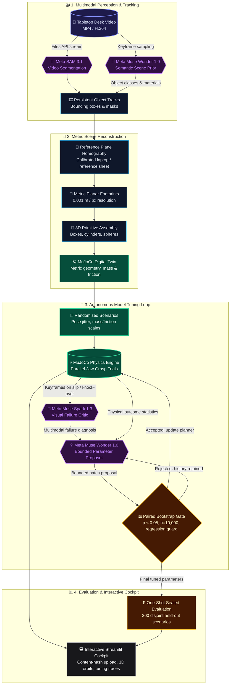

# SplatSAM

**Tabletop video → metric physics digital twin → autonomously tuned robot grasp planner.**

Built for the **Meta Global AI Developer Hackathon** (Indie Track / Push the Frontier). SplatSAM bridges computer vision and physical robotics: it converts casual phone or desk video into a metric 3D simulation sandbox in MuJoCo, automatically estimates physical properties, and uses Meta's frontier models to iteratively optimize robot grasping heuristics against randomized physical environments.

---

## Architecture



---

## Quickstart

### Prerequisites
- Linux (Ubuntu/Debian/Fedora)
- [uv](https://docs.astral.sh/uv/) & GNU Make
- Python 3.12 (managed automatically by uv)
- OpenGL / Mesa support (software OSMesa or EGL/llvmpipe)

```sh
# Clone repository
git clone https://github.com/Skrisps26/splatsam.git
cd splatsam

# Install locked dependencies and launch cockpit
make setup && make demo
```

Open **http://127.0.0.1:8501** in your browser.

| Command | Action |
| --- | --- |
| `make setup` | Install locked Python 3.12 dependencies and prepare workspace |
| `make demo` | Launch the dark interactive Streamlit cockpit on port 8501 |
| `make test` | Run the full automated test suite (68 tests, physics grasps, renderers) |
| `make export-ui RUN_DIR=...` | Export interactive media and presentation event timeline from a completed run |
| `make final-test RUN_DIR=... DATA_ROOT=...` | Execute the one-shot sealed evaluation across held-out scenarios |

---

## Interactive Cockpit & Content-Hash Upload

The dashboard is a dark, responsive Streamlit cockpit built for rapid inspection of perception, physics reconstruction, and planner optimization:

1. **Instant Content-Hash Upload**: Drag and drop any desk video (e.g. `data/videos/desk.mp4`). SplatSAM computes its SHA-256 digest in real time and matches existing recorded runs instantly without relying on hardcoded filenames or IDs. Unmatched videos stay private and can be saved for future processing.
2. **Progressive Stepper**: Follow the 7-stage pipeline:
   - **Understand scene**: Object detection and material/mass priors.
   - **Track objects · sam-3.1**: Persistent multi-object mask overlays.
   - **Measure scale**: Metric homography from calibrated references (closed laptop lid $35.7\text{ cm} \times 25.5\text{ cm}$ or standard reference).
   - **Build physics world**: Upright 3D MuJoCo primitive reconstruction and camera orbits.
   - **Generate scenarios**: Parameterized curriculum distributions (friction, mass, position jitter).
   - **Automatic tuning**: Live 8-round optimization history, accepted/rejected patch details, and token cost traces.
   - **Sealed test**: Held-out benchmark metrics with rigorous Wilson confidence intervals.
3. **Interactive Tools**:
   - Side-by-side **Comparison Slider** with keyboard support to compare recorded camera frames against the reconstructed physics world.
   - Autoplaying, looping **Grasp Simulation Media** showing physical parallel-jaw gripper trials.
   - **Failure Autopsy** tab categorizing mechanical failure modes (slip, knock-over, penetration).
   - **Download Center** for machine-readable JSON reports, Markdown summaries, and sanitized execution trajectories.

---

## Experimental Results & Robustness Evaluation

The parallel-jaw planner is evaluated against randomized MuJoCo scenarios with dynamic contact physics, surface friction variations ($[0.5, 1.5]\times$), mass scaling ($[0.5, 2.0]\times$), and clutter perturbations.

### 200 Held-Out Sealed Evaluation Benchmark

| Planner Configuration | Grasp Success Rate | Wilson 95% Confidence Interval |
| --- | ---: | --- |
| **Baseline Heuristic Defaults** | 69 / 200 (**34.5%**) | 28.3% – 41.3% |
| **Model-Tuned Parameters** | 95 / 200 (**47.5%**) | 40.7% – 54.4% |

- **Paired Statistically Significant Gain**: **+13.0 percentage points** (paired bootstrap 95% CI: **8.5 – 17.5 pp**, $n=10,000$ resamples).
- **Metric Scale Accuracy**: Independent scale error of **0.251%**, maximum planar dimension error of **8.13%**, and object footprint IoUs of **0.901 – 0.991**.
- **Live Workspace Execution**: On real tabletop footage containing a closed laptop reference, remotes, pen, and ball, the autonomous tuning loop executed across 8 rounds with live Muse Wonder proposals and Spark failure critic diagnoses, successfully achieving an accepted **+10.0 pp validation gain** (Round 6) while enforcing strict physical stability constraints.
- **Budget & Cost Efficiency**: Total cumulative Meta Model API spend across video segmentation, structured proposal generation, and multimodal vision diagnostics is **$1.1177**.

---

## How It Works

### 1. Zero-Shot Video Perception with SAM 3.1
Raw tabletop video is streamed to Meta SAM 3.1 via the Meta Files API (`purpose=user_data`). SAM 3.1 generates consistent multi-frame segmentation masks across camera movement. Real-time streaming chunks are parsed using `meta_sam_parser` to extract bounding boxes, centroids, and pixel-accurate silhouettes.

### 2. Metric Calibration & 3D Primitive Reconstruction
Using a known tabletop reference object (such as a standard closed laptop rectangle $357 \times 255\text{ mm}$ or reference paper), SplatSAM computes a planar homography to convert image coordinates to metric real-world coordinates ($0.001\text{ m/px}$). Mask silhouettes are fitted into native 3D simulation primitives (boxes, cylinders, spheres) with estimated mass and friction priors.

### 3. Closed-Loop Optimization with Muse Wonder 1.0 & Muse Spark 1.3
1. **Simulation Trials**: The parallel-jaw planner executes grasping trials in MuJoCo. Success requires raising the object $\ge 5\text{ cm}$ throughout a 2-second stationary hold with continuous finger contact.
2. **Visual Failure Diagnosis**: When grasps fail (dynamic knock-over, slippage, penetration), multi-frame keyframe sequences are sent to **Muse Spark 1.3** to identify physical failure causes.
3. **Structured Parameter Proposals**: **Muse Wonder 1.0** analyzes failure statistics and Spark diagnoses to propose bounded parameter adjustments (approach speed, pregrasp height, grip safety factor, jaw margin, clearance weights) via strict Pydantic JSON schemas.
4. **Validation Gate**: Candidate patches are simulated on a validation curriculum. A patch is accepted only if mean gain $\ge +2\text{ pp}$, the 10th-percentile bootstrap difference is strictly positive, and protected failure modes do not regress.

---

## Live Pipeline Execution

To process a new workspace video from scratch using live Meta APIs:

```sh
# 1. Supply your Meta Model API key in .env
echo "MODEL_API_KEY=your_key_here" >> .env

# 2. Stage B1: Zero-shot video tracking & scene reconstruction
uv run --env-file .env python scripts/run_pipeline.py \
  --mode live --action B1 --video data/videos/your_desk.mp4 --run-id my-workspace

# 3. Stage B2: Generate scenario curriculum & run autonomous tuning loop
uv run --env-file .env python scripts/run_pipeline.py \
  --mode live --action B2 --run-id my-workspace

# 4. Resume or extend the tuning loop (up to 8 total rounds)
uv run --env-file .env python scripts/resume_live_loop.py \
  --run-dir runs/my-workspace --max-total-rounds 8

# 5. Export interactive media and presentation events
uv run python scripts/export_real_ui.py --run-dir runs/my-workspace --record-grasp --seed 0
```

---

## Safety, Privacy & Design Principles

- **Deterministic Physics Scoring**: The MuJoCo physics engine determines grasp success and failure based on physical state, contact forces, and lift displacement—never an ungrounded LLM judgment.
- **Strict Budget Controls**: All Meta API requests are locked by a shared, file-locked budget tracker with input token preflighting (`/v1/responses/input_tokens`). Requests fail closed if budget limits are reached.
- **Local Data Privacy**: Raw user videos and frame captures remain strictly inside gitignored local directories (`data/videos/`, `runs/`). No private media is uploaded or committed.
- **Simulation Transparency**: Physical results reflect simulated parallel-jaw grasping with nominal mass/friction estimates. Physical properties are estimated from visual geometry unless explicitly measured.

---

## Documentation & References

- [Decisions & Architecture Notes](docs/decisions.md)
- [UI Artifact Inventory](docs/ui_artifacts.md)
- [Design System & Interface Specs](DESIGN.md)
- [Technical Write-up](docs/writeup.md)
